# Radio Command Center showcase

Thirteen screenshots of the actual dashboard, captured on the cloud computer on October 15, 2026.

Source: [`1209871`](https://github.com/SequoyahGeber/Radio-Recording-Transcription/commit/1209871dd63974527c7942c0db2f30311bc3a00a). Application implementation files were not changed.

## Demo data and capture limits

- All content is synthetic: the repository's disposable fixture supplies 176 transmissions across eight feeds and 2024–2026, plus 41 alerts. Three sample incidents, five tasks, and nine timeline links were added only to the marked disposable fixture database.
- These are desktop web-dashboard captures, not screenshots of the native macOS launcher. Detail images are 1180 × 757 pixels. The overview and incident images use normal browser zoom at 80% and are 1475 × 946 pixels, giving the header and content more room. Scrollable panels show their current viewport; this gallery is not a mobile-layout or full regression-test report.
- The server used its supported HTTP fixture option, `RADIO_BROWSER_TEST_TLS=0`. The unchanged app requires HTTPS for live WebSocket connections, so **Reconnecting…** and **0 operators** are visible. No browser security warnings were bypassed and no certificate trust settings were changed.
- Transcription and sync workers were deliberately not started. Their seeded heartbeats expired, leaving **Attention: worker, sync** and health warnings visible. These are fixture limitations, not evidence about a running production installation.
- No real recordings or private user data were used, and no transcription models were downloaded or run. The audio player uses the fixture's silent 80 ms WAV, which rounds to `0:00`.
- Screenshots were inspected for readability, private data and unexpected errors. The browser's original JPEG captures were re-encoded as PNG without changing their decoded pixels. No content was retouched or fabricated. The overview and incident images use the screenshot API’s viewport clip to exclude blank capture overscan from the zoomed browser.

## Gallery

### Operations board

Multi-feed dashboard with highlighted terms, review status and bookmarks. The visible pane shows Dispatch, Medical and Security; all eight feeds are available via horizontal navigation.

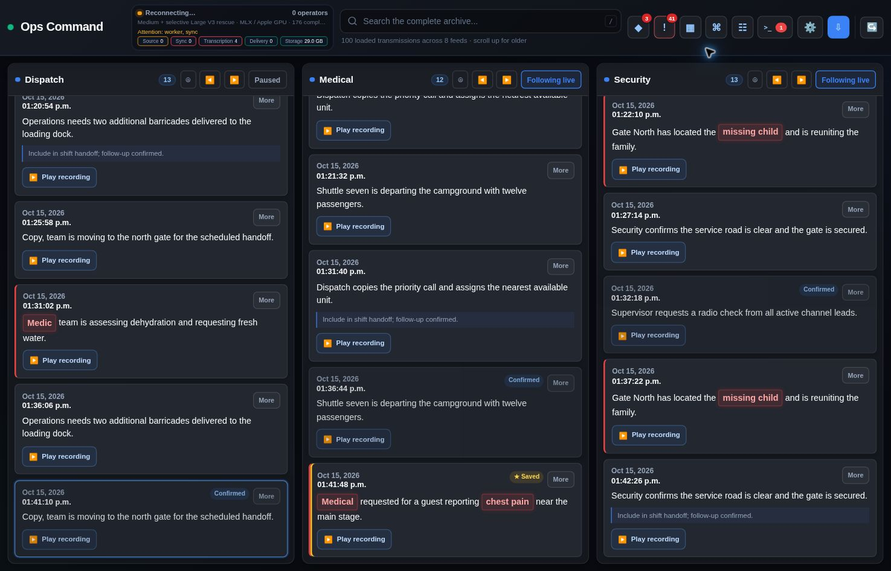

### Transmission review

Focused Dispatch feed with the review drawer, transcript, model comparison and note entry.

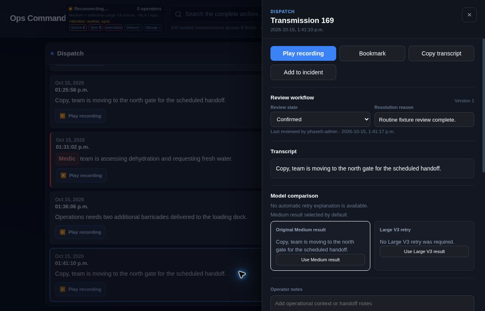

### Archive search

Indexed multi-year search for gate: 78 matching transmissions, filters, snippets and result actions.

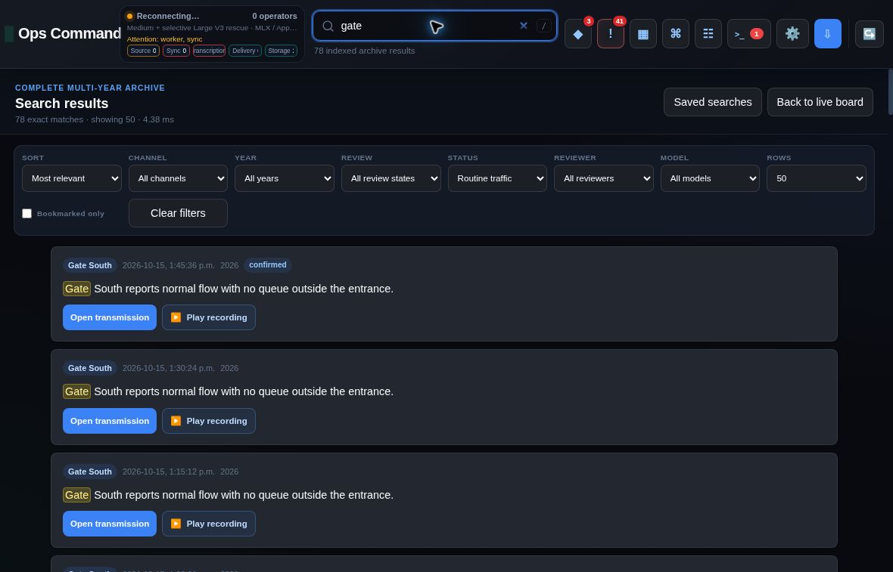

### Alert inbox

Synthetic alert list with severity, assignment, acknowledgement and false-positive controls.

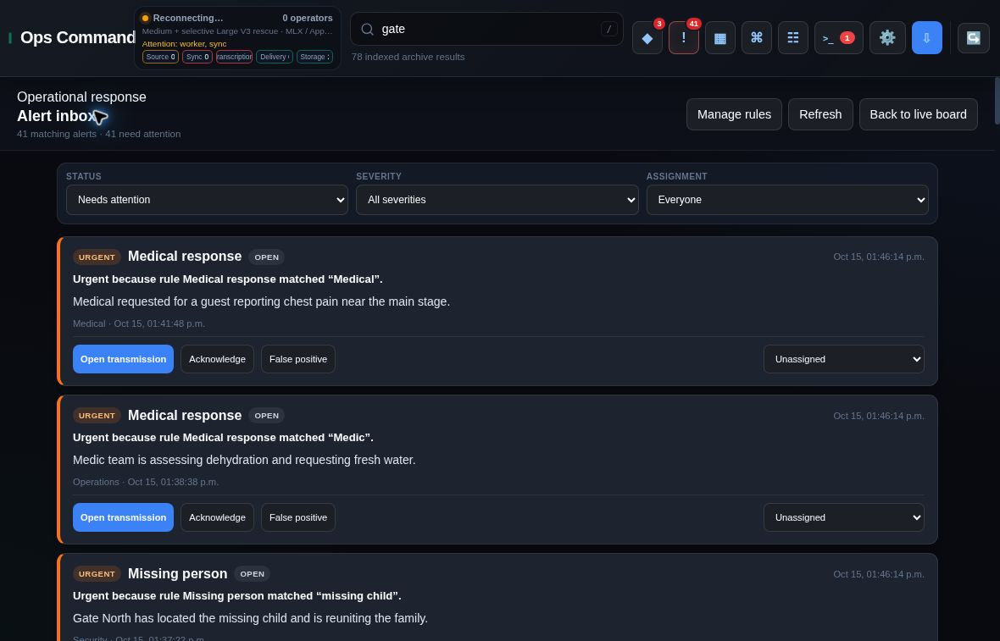

### Alert rule settings

Existing Safety assistance rule with terms, severity, match mode, exclusions and channel scope.

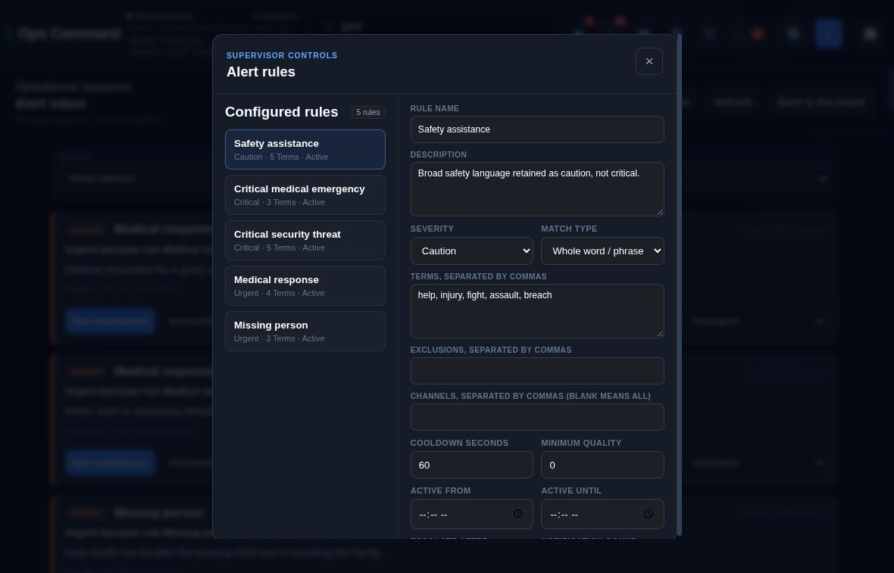

### Incident workspace

Three synthetic incidents with North gate arrival coordination selected, showing ownership, tags and linked timeline.

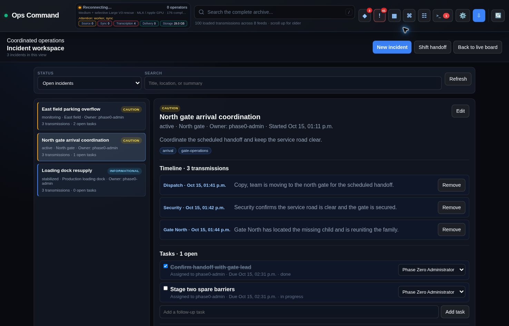

### Shift handoff

Generated handoff report with open incidents, active alerts, recent bookmarks and fixture health warnings.

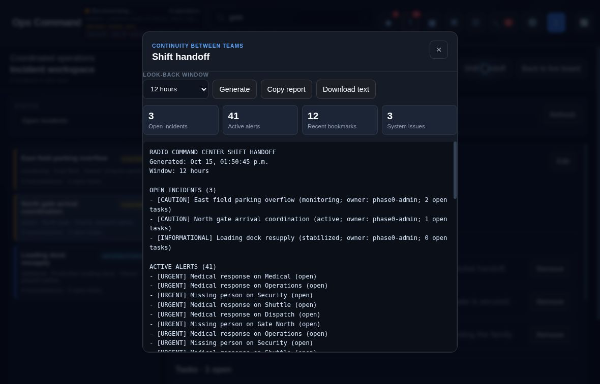

### Recording source settings

Source selection, scan timing, live-first window, backlog size and copy verification controls.

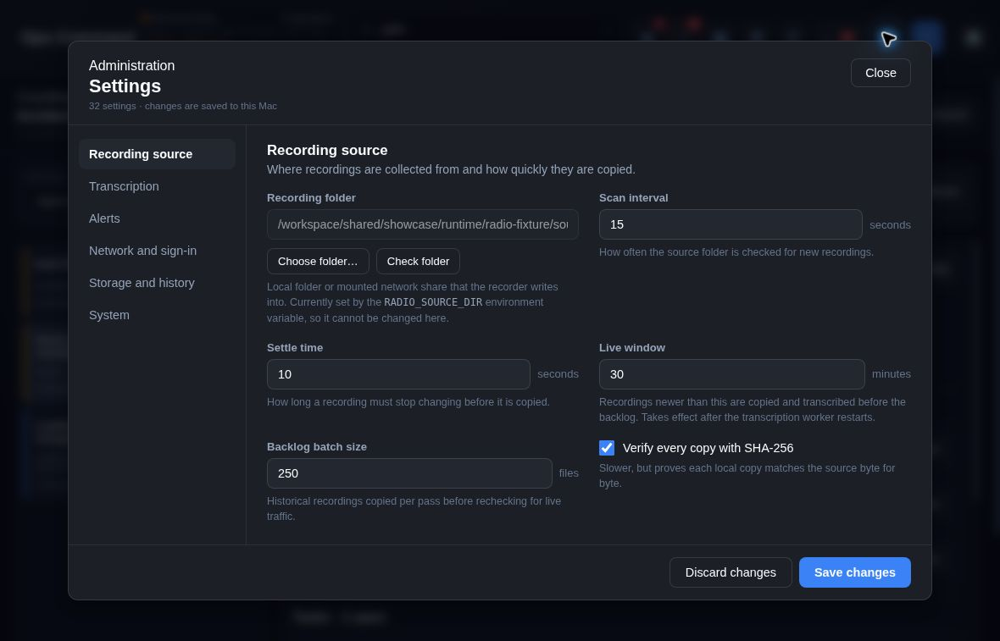

### Transcription settings

Engine and model choices, rescue-pass options and retry limits. No transcription engine was run.

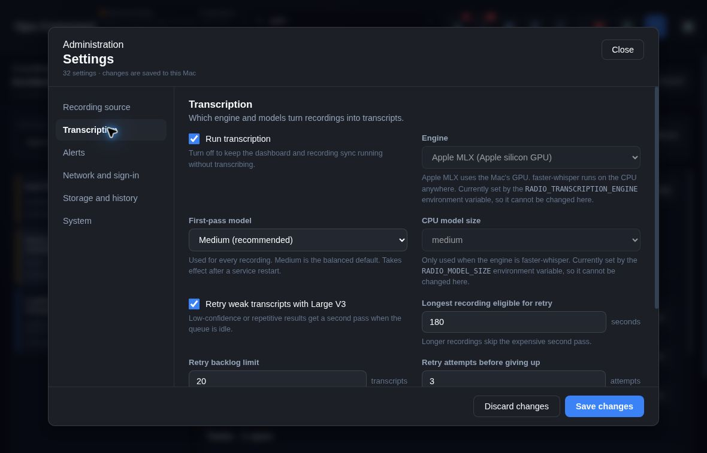

### Storage and retention

Disk reserve, backups, audit history, queue history and log rotation controls.

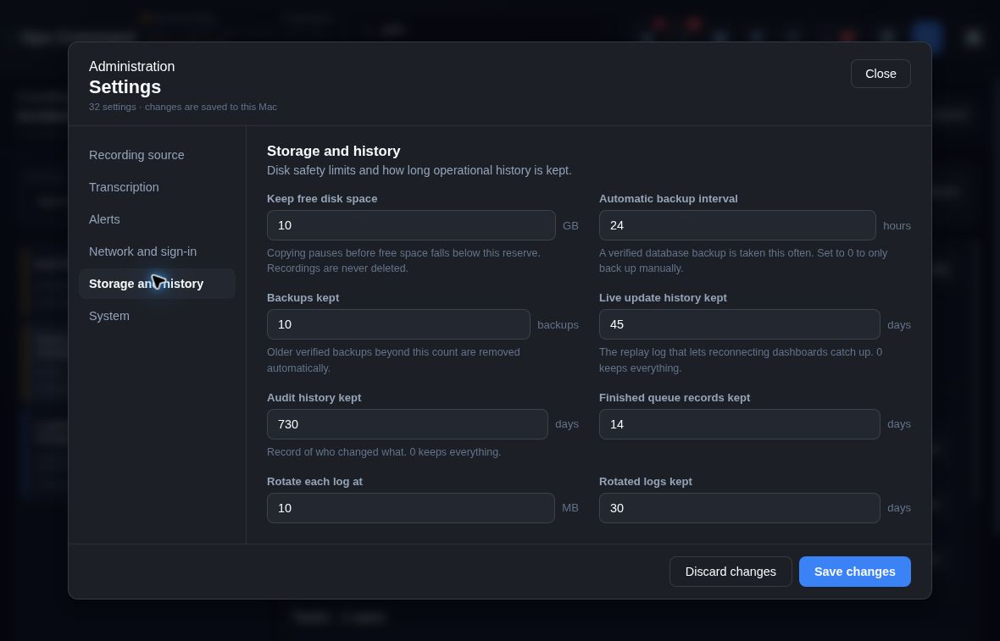

### System health

Actionable five-part health center; stale fixture worker/sync heartbeats are intentionally left visible.

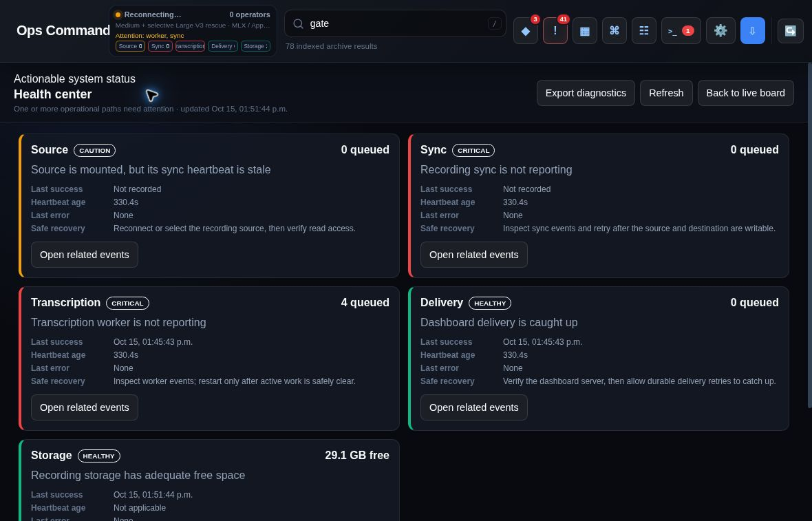

### Command palette

Search, playback, feed focus, density, workspace and keyboard-shortcut commands.

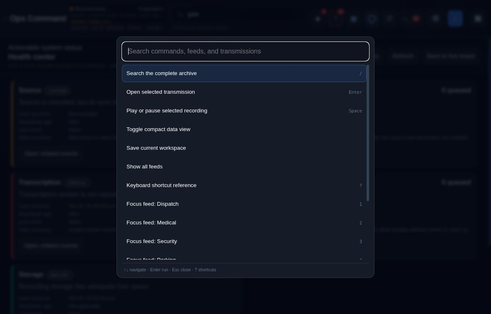

### Focused feed and audio player

Dispatch focus mode with global playback, seek, speed and volume controls; audio is an upstream silent 80 ms fixture.

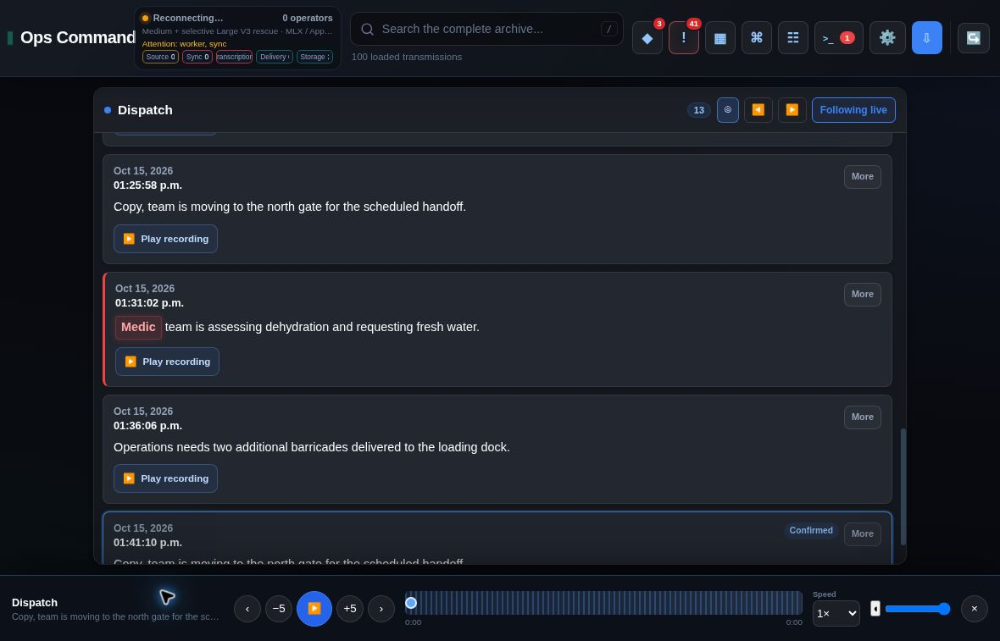

## Reproducing the base dashboard

Use the repository's browser fixture in an isolated local environment with the dashboard dependencies installed:

```sh
RADIO_BROWSER_TEST_TLS=0 \
RADIO_DISABLE_AUTOMATIC_BACKUP=1 \
HF_HUB_OFFLINE=1 \
RADIO_BROWSER_FIXTURE_ROOT=/tmp/radio-showcase \
python tests/browser/start_fixture_server.py
```

Open `http://localhost:8765/login` and use the public disposable test account defined in `tests/fixtures/dashboard_fixture.py`. Never use a production data directory. The standard fixture removes its marked temporary directory when the server exits. The three incident examples in this gallery are supplemental demonstration records; the base upstream fixture starts with no incidents.

See [manifest.json](manifest.json) for descriptions, pixel dimensions, file sizes, SHA-256 checksums and the capture boundaries.
